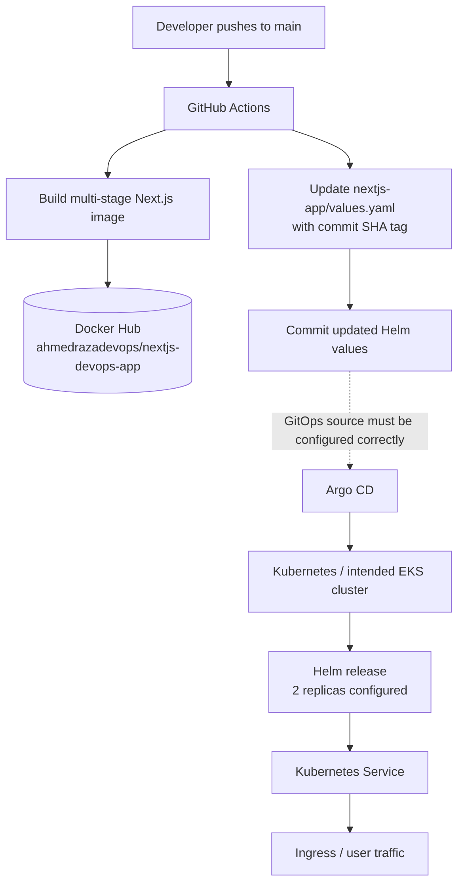

<div align="center">


  

</div>

---

# Automated CI/CD AWS Project

A DevOps learning project around packaging a Next.js application into a Docker image, publishing versioned images, and updating Helm configuration for a Kubernetes deployment.

    

[**Source code**](https://github.com/AhmedRaza92110/automated-CI-CD-aws-project) · [Workflow](.github/workflows/deploy.yml) · [Helm chart](nextjs-app/) · [Kubernetes manifests](k8s/)

## 🏗️ System architecture



## 🔁 What the current workflow does

The checked-in GitHub Actions workflow runs on pushes to `main`:

1. Checks out the repository.
2. Creates a short commit-SHA image tag.
3. Authenticates to Docker Hub using GitHub Actions secrets.
4. Builds and pushes both a commit-tagged image and `latest`.
5. Updates `nextjs-app/values.yaml` to use the commit tag.
6. Commits the updated Helm values back to the repository.

The repository also includes an EKS cluster configuration (`eks-cluster.yaml`), Kubernetes Deployment/Service/Ingress YAML, and a Helm chart with probes and optional autoscaling configuration.

## 🧩 Components and why they are chosen

| Component | Purpose | Why this choice |
|---|---|---|
| GitHub Actions | CI automation | Event-driven workflow close to source control |
| Docker multi-stage build | Package Next.js app | Separates dependency/build/runtime stages and runs as a non-root user |
| Docker Hub | Image registry | Simple registry for a portfolio demonstration |
| Kubernetes Deployment | Manage replicas and rollouts | Declarative desired state and controlled rolling updates |
| Service | Stable in-cluster endpoint | Decouples clients from changing pod IPs |
| Helm | Parameterize deployment | Keeps image tag, replicas, service and probe settings in one values file |
| Argo CD | Intended GitOps reconciler | Continuously reconciles the cluster against Git-defined desired state |
| Amazon EKS | Intended managed Kubernetes target | Managed control plane for learning AWS Kubernetes operations |

## 🚦 Current implementation vs. next steps

**Present in the repository:** Dockerfile, GitHub Actions image build/push workflow, Helm chart, Kubernetes manifests, and EKS cluster config.

**Verify/configure before treating as end-to-end deployment:**

- [ ] `argocd-application.yaml` currently references `https://github.com/AhmedRazaDevOps/project1.git`; change it to the correct repository URL and path before syncing.
- [ ] The workflow updates Helm values in the same repository and pushes a commit, which can retrigger the workflow. Add a path filter/skip strategy or move desired-state manifests to a separate GitOps repository.
- [ ] The current workflow builds and pushes images but does not provision EKS or install/configure Argo CD.
- [ ] Configure a real Ingress controller, DNS and TLS before expecting external traffic; the sample Ingress uses `nextjs.local`.
- [ ] Add automated tests, Trivy scanning, dependency auditing, immutable image tags and a deployment verification/rollback stage.
- [ ] Use GitHub Actions OIDC for AWS access if AWS deployment steps are added; avoid long-lived cloud keys where possible.

## 🔐 Secrets

Configure `DOCKERHUB_USERNAME` and `DOCKERHUB_TOKEN` in repository Actions secrets. Never store registry tokens or AWS credentials in YAML. Review the workflow permissions and keep write access limited to the job that updates Git state.

## 🛠️ Run locally

Prerequisites: Node.js/npm and Docker.

```bash
npm ci
npm run dev
```

For a local container build:

```bash
docker build -t nextjs-devops-app:local .
docker run --rm -p 3000:3000 nextjs-devops-app:local
```

Open `http://localhost:3000`.

## 📂 Key files

- `.github/workflows/deploy.yml` — image build/push and Helm tag update.
- `Dockerfile` — multi-stage production image.
- `nextjs-app/` — Helm chart, values, deployment/service/ingress templates.
- `k8s/` — example raw Kubernetes resources.
- `eks-cluster.yaml` — eksctl cluster configuration.
- `argocd-application.yaml` — Argo CD Application resource (update its source URL before use).

> **Portfolio note:** The README separates the current CI workflow from AWS/EKS and Argo CD steps that still require environment setup. Document successful deployment evidence after those steps have been tested in your own account.
